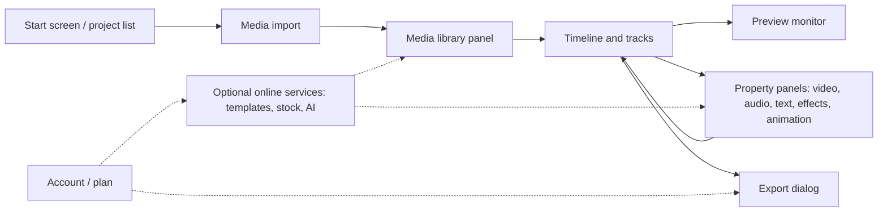

# Chapter 1: Understanding CapCut Desktop

**Draft v1, 25 October 2026.** Evidence labels are defined in `00_master_toc_and_research_log.md`. Where this chapter cannot cite an official page, it says so.

---

## 1.1 What CapCut Desktop is

**Layer A (observable)**

CapCut is a video editing application with versions for mobile, web, and desktop. The desktop version targets Windows and macOS. [SECONDARY: bigvu.tv guide] reports that the desktop app runs on Windows 10 and later and macOS 10.15 and later. [SECONDARY: primalvideo.com] reports that the layout is the same on both desktop platforms. The official minimum requirements page has not yet been read, so treat the OS floor as unconfirmed.

CapCut's own help center describes two ways to update the desktop app: download the installer again from the official site, or press the Update button at the top right of the app [OFFICIAL: capcut.com/help/why-update-to-a-new-version]. This tells us the app contains an in-app update check, which is a common pattern (see Chapter 19).

**Layer B (general)**

Editors fall on a spectrum:

| Type | Core idea | Example behavior |
|---|---|---|
| Template-based editor | User fills slots in a prebuilt edit | Drop clips into numbered placeholders |
| Simple storyboard editor | A single sequence of items | Reorder thumbnails, no overlap |
| Non-linear editor (NLE) | Multiple tracks on a time axis, clips reference source media non-destructively | Overlap clips, trim without altering the file |

CapCut desktop is described by third parties as having multi-track editing and keyframes [SECONDARY: skillademia.com, commercial interest], which places it in the NLE category, with template features layered on top. Treat the exact track limits as **[UNKNOWN]**.

## 1.2 Desktop, Web, and Mobile

| Aspect | Desktop | Web | Mobile |
|---|---|---|---|
| Reported capability | Most capable [SECONDARY] | Basic edits, slower, limited advanced features [SECONDARY] | Origin of many trending templates [SECONDARY] |
| Keyboard shortcuts | Yes [SECONDARY: fastshortcuts.com] | Unverified | None (touch only) [SECONDARY] |
| Template library | Accessed from the project-creation screen; differs from mobile [SECONDARY] | Smaller [SECONDARY] | Largest [SECONDARY] |

One persistent compatibility concern is reported: projects started from a mobile template sometimes display incorrectly on desktop [SECONDARY: bigvu.tv]. This is a vendor with a commercial interest, so it is an indicator, not proof.

**Why this matters for a new editor (Layer C):** a project format shared across platforms needs an explicit version number and tolerant loading, because features differ between clients. See Chapter 16.

## 1.3 Typical project flow

A conventional flow, which matches the course outlines found in research [SECONDARY: Udemy course descriptions], is:

1. Create or open a project from the start screen, which lists previously created projects [SECONDARY: Skillshare class description].
2. Import media.
3. Place media on the timeline; trim, split, arrange.
4. Add text, audio, effects, transitions, keyframes.
5. Preview.
6. Export.

Each step is expanded in Chapter 4.

## 1.4 Feature categories and local versus online dependence

CapCut-specific claims in this table are **[SECONDARY]** unless stated otherwise. The "Local?" column is **[UNKNOWN]** for anything not documented by CapCut and must be verified in Chapter 18.

| Category | Examples named in sources | Local vs online |
|---|---|---|
| Core editing | Trim, split, multi-track, keyframes, speed | Likely local (general expectation for NLEs); not verified |
| Templates | Template library on the project screen | Sources note that templates may fail to load when the connection or app version is a problem, which suggests online fetching [SECONDARY: bigvu.tv] |
| Captions | Auto captions | **[UNKNOWN]** whether speech recognition runs locally |
| Background removal, motion tracking, AI voice | Named in several tutorials | **[UNKNOWN]** |
| Search over local files | One guide says a search tool analyzes local files [SECONDARY: parrainduweb.fr] | **[UNKNOWN]** where the analysis runs |
| Stock content | Built-in music and effects library, with unclear licensing [SECONDARY: primalvideo.com] | Likely downloaded on demand; unverified |

**Rule for the later coding agent:** do not assume any AI feature is local because it appears in a desktop window.

## 1.5 Plans, limits, licensing

- A free tier and a paid Pro tier exist [SECONDARY, several sources]. One guide says the free tier is more limited than before [SECONDARY: primalvideo.com].
- One shortcut site claims desktop exports up to 4K [SECONDARY, commercial interest]. Official export limits must be confirmed in Chapter 15.
- Watermark behavior and Pro-only assets vary by version and region and are **[UNKNOWN]** here.
- Prices were quoted only in third-party guides and change often. They are deliberately omitted.

## 1.6 What can and cannot be learned from the user experience

**Can be learned:** visible workflow, feature categories, interaction patterns, and what the user is allowed to do at each step.

**Cannot be learned:** internal architecture, media engine, project format, caching behavior, or AI model details. Nothing in the sources found so far documents these. Do not infer them from the interface.

## 1.7 Feature map

Solid arrows are the basic editing loop. Dashed arrows are features that may depend on online services or account state (status of each: see 1.4).

## What a Future Coding Agent Must Understand

- **Verified:** only the update behavior (official). Everything else in this chapter is secondary-source description of the user experience.
- **Core concept:** the product is an NLE with template and AI conveniences layered on; the foundation is non-destructive multi-track editing (Chapters 7 and 8).
- **Do not copy:** CapCut's interface layout, branding, templates, or stock assets. Reproduce editing concepts, not the product.
- **Open questions:** current version, exact plan limits, which features need the network.
- **Design consequence:** separate "works offline" features from "needs a service" features in the architecture from day one (Chapter 19, Chapter 22).
- **Read next:** Chapter 2 (interface), Chapter 8 (timeline), Chapter 16 (projects).
