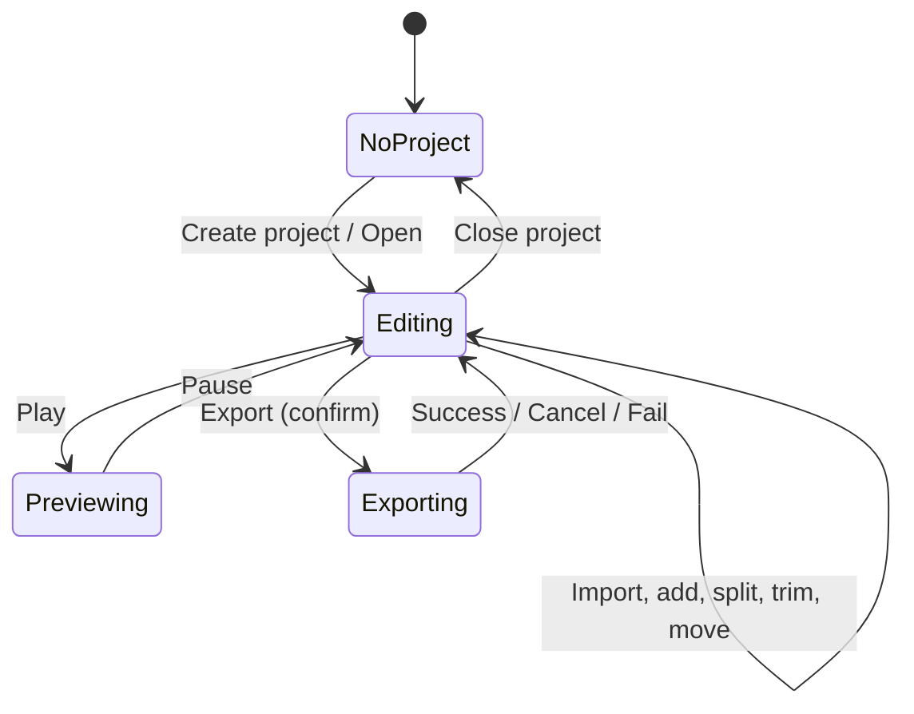

# Chapter 4: Interaction Sequences and Behavioral Specifications

**Draft v1, 25 October 2026.** Each workflow separates what official CapCut pages document (S7: https://www.capcut.com/help/export-videos-in-capcut, S8: https://www.capcut.com/resource/how-to-use-capcut-on-pc, accessed 25 Oct 2026) from what a general editor would do and what a developer should decide. **Only 4 of the 25 required workflows have any official documentation, and only at step-label level.** For the rest, this chapter gives a **[PROPOSED]** reference behavior based on general NLE practice and Chapters 5-16. It must not be read as CapCut's behavior.

Legend: **D** = documented by CapCut; **P** = proposed/general; **U** = unknown for CapCut.

---

## 4.1 Workflow summaries

### W1. Create a new project
- **D:** From the main interface choose "Create project" (S8).
- **U:** whether a settings dialog appears, default ratio/fps, naming.
- **P:** Project created with default settings (resolution, frame rate, audio rate), an empty timeline, selection empty, playhead 0, status clean-but-unsaved. Project settings may adapt to the first clip (a decision to record).

### W2. Open an existing project
- **U:** project list layout and open gesture; secondary sources mention a start screen listing prior projects.
- **P:** Resolve the project file, migrate, validate, locate assets, show offline summary (Chapter 16, 24.13).

### W3. Import video, audio, images
- **D:** click "Import" in the media panel to upload from the device (S8).
- **U:** formats, multi-select, folder, drag-drop.
- **P:** Probe each file, register assets, enqueue thumbnails/waveforms, show an import report for failures (Chapter 7). Visible response: items appear in the media panel, thumbnails fill in.

### W4. Add media to the timeline
- **D:** "Drag the imported files into the timeline to start editing" (S8).
- **U:** snapping, track auto-creation, overwrite/insert.
- **P:** Create clip(s) (linked audio if present), place at drop position, snap to nearest target, select the new clip(s). State changes: timeline gains clip, dirty flag set.

### W5-W9. Reorder, select, split, trim, move
- **D (split only):** select the video in the timeline, put the playhead where the split should happen, click the Split icon; repeat as needed (S8).
- **U:** everything else.
- **P:** Split per Chapter 24.4, trim per 24.5, move per 24.6. Selection after split: choose and document (right half selected is common). All edits are single undo steps.

### W10. Delete and restore an edit
- **U:** delete key, ripple behavior, undo/redo buttons.
- **P:** Delete clip as one command; undo restores clip and selection; ripple optional (Chapter 8, 8.7).

### W11-W12. Change playback position; zoom and navigate the timeline
- **U** (no official text).
- **P:** Click ruler or drag playhead (scrub); keyboard frame step; zoom changes pixels-per-second; scroll offset persists (Chapter 8, 8.15).

### W13-W14. Clip properties; resize, crop, position, rotate
- **D:** "Video" > "Basic" panel exists, with "Auto reframe" and aspect-ratio selection (S8).
- **U:** transform fields, on-canvas handles.
- **P:** Property panel as a function of selection; edits via commands; animatable (Chapter 10).

### W15. Change playback speed
- **D:** speed adjustments and reversal are listed as editing features (S8, feature description).
- **U:** control location and ranges.
- **P:** Speed as clip property; duration recomputed; audio policy (Chapter 8, 13).

### W16. Transitions and effects
- **D:** "Transition" tab lists transitions to apply between clips; "Filters" and "Effects" > "Video effects" apply looks and effects (S8).
- **U:** drag vs click apply, duration handles.
- **P:** Transition requires adjacent clips and handles (Chapter 11, 11.7).

### W17. Text and titles
- **D:** "Text" > "Add text" places a text box on the timeline; a right-side editor takes the text (S8).
- **P:** Text item with default style at playhead, selected, editable in place (Chapter 12).

### W18. Generate/edit captions
- **D:** "Captions" > "Auto captions", select the video's language, click "Generate" to create synced captions (S8).
- **U:** processing location, progress UI, correction interface.
- **P:** Extract audio, run recognition, create subtitle track, preserve manual edits on re-run (Chapter 12, 12.7).

### W19. Add and edit audio
- **D:** "Audio" > "Music" for background tracks; "Sound effects"; "Voice changer" > "Voice filters" (S8).
- **U:** volume/fade controls.
- **P:** Library item becomes an audio clip on a new or selected audio track (Chapter 13).

### W20. Keyframes
- **D:** keyframes are listed as a feature (S8).
- **U:** UI.
- **P:** Capture current value at playhead, interpolate (Chapter 10, 10.4-10.5).

### W21. Multiple layers
- **U:** track model.
- **P:** Higher video tracks composite over lower (Chapter 8, 8.8; Chapter 9, 9.6).

### W22. Save and reopen
- **U:** save model; secondary sources suggest autosaved drafts, unverified.
- **P:** Chapter 16 safe-save and recovery.

### W23. Export
- **D (S7, S8):** click "Export" at the top right; set resolution (desktop includes 2K and 4K), frame rate (up to 60 fps depending on source), bitrate; click "Export" again to save to the device; file name, save location, format, and codec are listed among the settings; optional sharing to YouTube/TikTok.
- **D (conditions, S7):** 4K availability depends on device hardware, operating system, platform, source media resolution, and (for the web version) account plan; high frame rate may restrict the maximum resolution offered on mobile.
- **U:** progress dialog, cancel, failure messages.
- **P:** Snapshot, validate, render, finalize, verify (Chapter 15).

### W24-W25. Missing media; failed/cancelled operations
- **U** for CapCut. **P:** Chapter 7 (offline placeholders, relink) and Chapter 21 (typed errors, cleanup).

## 4.2 Interaction state table (documented split workflow)

| Current state | User action | Expected result | Important exceptions |
|---|---|---|---|
| Clip on timeline, playhead inside it, clip selected | Click Split | Clip divided at playhead | **U** whether unselected clips split too; whether linked audio splits |
| Playhead at clip boundary | Click Split | [P] no-op with feedback | **U** |
| No clip selected | Click Split | **U** (some editors split all tracks at playhead) | **U** |
| Locked track | Click Split | **P** reject | **U** |

## 4.3 Expectations that should not be assumed without evidence

Keyboard shortcuts identical to other editors; magnetic timeline behavior; ripple on delete; automatic gap closing; linked audio always splitting; auto-saved projects; whether Auto reframe is keyframe-based or destructive; whether captions remain after retrim; offline operation of AI features.

## 4.4 Example interaction diagram (proposed)

## What a Future Coding Agent Must Understand

- Officially documented workflow steps are few and label-level (create project, import, drag to timeline, split, apply tabs, auto captions, export). Everything else is proposed.
- Define selection, playhead, and linked-clip behavior yourself and test it (Chapters 5, 8).
- Several features have environment-dependent availability (hardware, plan, online); model availability explicitly.
- **Verified:** sequences for W1, W3, W4, W5 (split), W16-W19, W23 at step-label level. **Remaining:** most behavior.
- **Related:** Chapters 2, 3, 5, 7, 8, 12, 15, 16, 21, 24.
