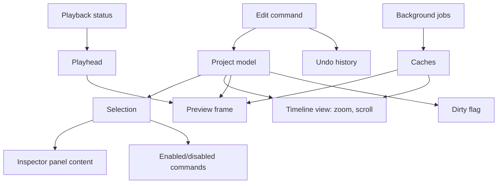

# Chapter 5: General Interface and Application State

**Draft v1, 25 October 2026.** **[GENERAL]** and **[PROPOSED]**. This is an engineering model of how an editor with similar functionality can manage state. It is **not** CapCut's internal state architecture, which is **[UNKNOWN]**.

---

## 5.1 Six kinds of state

| Kind | Examples | Saved to project file? | Undoable? |
|---|---|---|---|
| 1. Temporary interface state | Open panel, scroll position, hover, selected tab, dialog open | No (maybe remembered in user preferences) | No |
| 2. Editable project state | Clips, tracks, effects, keyframes, text | Yes | Yes |
| 3. Persistent project data | The serialized form of kind 2, plus project settings and asset table | Yes (it is the file) | Via history, not the file |
| 4. Playback state | Playhead, playing/paused, loop, preview quality | Playhead optionally | No |
| 5. Background job state | Import probing, thumbnails, proxy build, export | No (jobs are re-derivable) | No |
| 6. Cache and derived data | Thumbnails, waveforms, frame cache, proxies | No (disposable) | No |

Selection (selected clip, track, tool) is a seventh, borderline case: it is interface state, but edit commands depend on it, so it must be designed deliberately (5.4).

## 5.2 State inventory

| State item | Owner | Notes |
|---|---|---|
| Active project | Application | None, loading, ready, saving, closed |
| Selected media item | Library view | May reference an asset that goes offline |
| Selected timeline clip(s) | Selection model | Set of clip IDs, never object copies |
| Selected track | Timeline view | Determines paste/insert target |
| Selected tool | Tool state | Select, blade/split, etc. (naming varies) |
| Playhead position | Playback | Exact time (see Chapter 8) |
| Timeline zoom, scroll | Timeline view | Pixels per second, offset |
| Open panels / active inspector | Layout | Inspector content follows selection |
| Preview mode | Playback | Quality, proxy on/off |
| Playback status | Playback | stopped, playing, scrubbing, seeking |
| Save status | Document | clean, dirty, saving, save-failed |
| Modal dialogs | Application | Block or redirect input |
| Background operations | Job system | Per job state |
| Keyboard focus | UI toolkit | Decides shortcut routing (5.6) |

## 5.3 Dependencies between states



Rules:

- The **project model is the single source of truth** for edit data. Views read it; they do not hold copies.
- Selection stores **IDs**. After any edit, validate selection: remove IDs that no longer exist.
- The inspector is a function of (selection, project model). It never has its own copy of a clip's properties.
- Command enablement is a function of (selection, playback status, modal state, project state), computed in one place.

## 5.4 Selection model

```text
Selection { clip_ids: set, track_id: optional, asset_ids: set, anchor: optional }
```

Events that must update it: clip deleted, clip split (decide whether to select left, right, or both), clip moved to another track (keep selected), undo/redo (restore the selection recorded with the command), project reload (clear), asset removed.

Clicking in empty timeline space: clear clip selection, optionally set the playhead. Multi-select: add/toggle with a modifier, range with another modifier. Exact keys are **[UNKNOWN]** for CapCut; follow platform conventions.

## 5.5 Command-driven editing

All project changes go through **commands** (add clip, split, trim, set property). A command:

1. checks preconditions,
2. applies changes to the project model,
3. records enough to undo,
4. marks the project dirty,
5. emits change events.

UI controls only create commands. This gives one place for validation, undo, and logging (Chapter 16).

## 5.6 Keyboard focus and shortcut routing

Problem: pressing a letter must trigger an editing shortcut on the timeline but type a letter in a text field.

```text
function on_key(event):
    if modal_dialog_open: route to dialog; return
    if focused_widget.is_text_input: let it handle text; allow only
        shortcuts explicitly marked "works while typing" (e.g., Ctrl+S); return
    context = active_panel(focused_widget)     # timeline, library, preview...
    command = keymap.lookup(context, event.key_chord)
    if command and command.enabled(): run(command)
```

A third-party source says CapCut letter shortcuts stop working while a caption or text box is focused [SECONDARY: fastshortcuts.com]. This is consistent with the routing above but does not prove CapCut's implementation.

Shortcut conflicts: the keymap must detect duplicates per context and warn on rebinding.

## 5.7 Context menus and disabled controls

Build menus from the same command registry as toolbars, so enablement logic is not duplicated. Show a disabled control with a reason (tooltip) when feasible, instead of hiding it, so users learn the preconditions.

## 5.8 Loading, processing, error, completion

Model each long operation with explicit states:

```text
idle -> running(progress) -> succeeded | failed(error) | cancelled
```

Never represent these with scattered booleans like `isLoading`, `hasError`, `isDone`; combinations become impossible states.

## 5.9 Save status

```text
clean -> dirty (any command) -> saving -> clean | save-failed(error)
```

Edits that arrive during `saving` must not be lost: snapshot the data being saved, keep editing the live model, and mark dirty again if anything changed after the snapshot.

## 5.10 Common state bugs

| Bug | Cause | Fix |
|---|---|---|
| Inspector shows stale values after undo | Inspector holds a copy | Derive from model; refresh on change events |
| Crash on "delete selected" after another delete | Selection holds object pointers | Hold IDs, validate |
| Shortcut types into timeline while typing | Focus not considered | Routing in 5.6 |
| Playhead beyond end after trim | No clamp | Clamp on timeline-length change |
| Two background jobs for the same thumbnail | No de-duplication | Key jobs by (kind, asset, range) |
| Dirty flag stuck after undo to the saved point | Boolean dirty | Track a history index at save time |
| Export uses edited-after-click data | No snapshot | Export from an immutable snapshot of the project |
| UI freezes on large import | Work on the UI thread | Background jobs |

## 5.11 Threading rules [PROPOSED]

- The project model is modified only on one thread (or behind one lock/queue).
- Workers read immutable snapshots or request data through messages.
- Results from workers carry a **version tag**; discard results whose tag is older than the current model for that item.

## What a Future Coding Agent Must Understand

- Separate the six kinds of state; only project state is saved and undoable.
- One source of truth, commands as the only mutation path, selection by ID.
- Derive inspector and command enablement from state; do not cache copies.
- Explicit state machines for long operations and save status.
- Keyboard routing must respect focus and modal state.
- **Verified:** nothing CapCut-specific besides one secondary claim about text-field focus.
- **Related:** Chapters 8, 16, 17, 21, 24.
