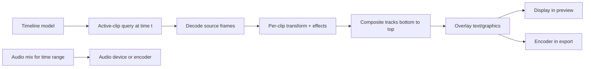

# Chapter 9: Playback, Preview, and Rendering Architecture

**Draft v1, 25 October 2026.** **[GENERAL]** and **[PROPOSED]**. CapCut's preview engine is **[UNKNOWN]**. FFmpeg's graph-based filtering library (libavfilter, "a generic audio/video filtering framework" per https://ffmpeg.org/libavfilter.html, FFmpeg project, accessed 25 Oct 2026) is cited only as one example of a filter-graph design.

---

## 9.1 Preview vs final render

| | Preview | Export |
|---|---|---|
| Goal | Responsive feedback | Exact, complete output |
| Timing | Real-time, may drop frames | As slow as needed, never drops |
| Resolution | Often reduced | Full |
| Sources | May use proxies | Originals |
| Effects quality | May use cheaper approximations | Full quality |
| Audio | Live output device | Mixed to file |

**Consistency rule [PROPOSED]:** preview and export must call the *same* evaluation code (the same "what is on screen at time t" function and the same effect math), differing only in quality settings, not in logic. Divergent code paths are the main source of "it looked different after export".

## 9.2 Pipeline overview



## 9.3 Decoding and seeking

- Decode in a worker thread, not the UI thread.
- Random access in long-GOP media: seek to the preceding I-frame, decode forward, discard until the target. Cost grows with GOP length.
- **Frame cache:** keep recently decoded frames keyed by (asset, source time, scale). During forward playback, read-ahead several frames. During scrubbing, prefer showing the nearest cached frame immediately, then refine to the exact frame.
- **Hardware decode** (on Windows typically via DXVA/D3D11 video decode paths): faster and cooler, but support depends on GPU, driver, codec, profile, and bit depth; always keep a software fallback. Exact capability on a given PC must be queried at runtime, not assumed.

## 9.4 The playback clock

Two designs:

1. **Audio as master clock [common]:** the audio device consumes samples at a steady rate; the current playback time is derived from samples played. The video side picks the frame whose timestamp matches that time, dropping or repeating frames as needed. Audio never glitches because of slow video.
2. **System clock as master:** simpler; use when there is no audio or when audio is muted. Needs care to avoid drift versus audio.

```text
loop each display refresh:
    now = clock.position()                  # audio samples played / rate
    target_frame = floor(now * project_fps)
    if frame_ready(target_frame): present it
    elif next frames late: present last frame; count a dropped frame
    request decoding for target_frame + lookahead
```

Pause: stop the clock, keep the last presented frame. Seek: flush audio buffers and frame queues; rebuild from the new position; resume.

## 9.5 Audio path

- Mix all active audio clips for the next buffer window (e.g., 10-50 ms chunks): apply clip gain, fades, track gain, mute/solo, sum in 32-bit float, clamp or limit at output.
- Resample to the device rate when needed.
- Handle device change (headphones unplugged): reopen the device, keep the logical clock continuous.
- Scrubbing audio is optional; a short snippet playback is common.

## 9.6 Compositing

Per output frame:

```text
canvas = transparent or background color at project resolution
for track in visible video tracks, bottom to top:
    for clip active at t on that track:
        img = decoded frame -> convert to working pixel format
        img = apply clip effects chain (in order)
        img = apply transform (position, scale, rotation, crop, opacity)
        canvas = blend(canvas, img, blend_mode)
for overlay in text/graphics: render and blend
```

Use **premultiplied alpha** internally for correct blending. Choose a working format (for example 8-bit RGBA for simplicity, 16-bit float for quality; the choice affects memory and performance, see 9.9).

## 9.7 CPU vs GPU processing

| Approach | Strengths | Weaknesses |
|---|---|---|
| CPU compositing | Simpler, portable, deterministic | Slow at high resolution and many layers |
| GPU compositing (Direct3D, OpenGL, Vulkan) | Fast transforms, blends, shaders | Driver differences, upload/download costs, more complex |
| Hybrid | Decode on GPU, composite on GPU, encode on CPU or GPU | Needs careful format and memory handling |

Avoid readbacks from GPU to CPU inside the preview loop; they stall. For export, a readback per frame is usually needed unless the encoder accepts GPU surfaces.

Integrated GPUs share system RAM, so GPU memory pressure competes with everything else (Chapter 20).

## 9.8 Architecture options

1. **Single-threaded evaluator:** simplest, poor responsiveness.
2. **Producer/consumer pipeline:** decoder threads feed a frame queue; a render thread composites; the UI thread presents. Good default.
3. **Separate engine process:** the UI talks to a media engine over IPC. Isolates crashes and memory growth; adds IPC cost and complexity for frame transport (shared memory or GPU surface sharing).
4. **Filter-graph engine:** build a graph of nodes (source, effect, composite, sink) and pull frames through it. FFmpeg's libavfilter is graph-based; custom graphs give finer control over caching and invalidation.

Trade-offs depend on team size, language, and framework; none is universally best.

## 9.9 Memory per frame

| Resolution | 8-bit RGBA | 16-bit float RGBA |
|---|---|---|
| 1920x1080 | about 8.3 MB | about 16.6 MB |
| 3840x2160 | about 33 MB | about 66 MB |

A cache of 60 frames at 4K 8-bit RGBA is about 2 GB. Bound all caches by bytes, not by count.

## 9.10 Preview quality controls

- Preview resolution scale (full, 1/2, 1/4).
- Proxy toggle.
- Effect quality toggle (skip expensive effects during playback).
- Frame-drop vs slow-down policy: **drop frames and keep audio on time** is standard.

## 9.11 Special cases

- **Variable frame rate:** use per-frame timestamps from the container.
- **Different source and project frame rates:** frame selection by nearest timestamp (or blend, optionally).
- **Missing media:** render a clear placeholder frame, keep audio silent for that clip, show a warning.
- **End of timeline:** stop at the last frame; optionally loop.
- **Frozen/stalled decoder:** timeout, show last frame, report error, do not hang the UI.

## 9.12 Why preview can differ from export

Proxy resolution, skipped effects, different color conversion paths, different scaling filters, GPU vs CPU math differences, audio device resampling vs offline resampling. Minimize by sharing code (9.1), documenting known differences, and offering a "full quality preview" mode.

## 9.13 Background rendering and cache reuse

Optionally pre-render complex regions into an intermediate cache. Key the cache by a hash of everything that affects the pixels (source IDs and ranges, effect parameters, transform, resolution). Any edit changes the hash and invalidates only affected regions.

## What a Future Coding Agent Must Understand

- Preview and export must share evaluation logic; only quality settings differ.
- Audio is usually the master clock; video adapts by dropping or repeating frames.
- Decode, composite, and present on separate threads; never block the UI thread.
- Seeking in long-GOP media is expensive; use frame caches and proxies.
- Bound caches by bytes; integrated GPUs share system memory.
- Query hardware capabilities at runtime and keep software fallbacks.
- **Verified:** only the existence of a graph-based FFmpeg filtering library. All else is general design.
- **Related:** Chapters 6, 7, 8, 11, 15, 19, 20, 24, 25.
