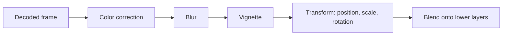

# Chapter 11: Effects, Filters, Compositing, and Transitions

**Draft v1, 25 October 2026.** Layers B and C are **[GENERAL]** and **[PROPOSED]**. CapCut effect names named in secondary sources (for example "Glare", "Tearing Paper", "3D Zoom Pro" [SECONDARY: litcommerce.com]) are listed only as examples of user-visible effects; their behavior and implementation are **[UNKNOWN]**. FFmpeg's libavfilter, described as a generic audio/video filtering framework (https://ffmpeg.org/libavfilter.html, accessed 25 Oct 2026), is cited as one reference design for filter chains.

---

## 11.1 Vocabulary

| Term | Definition | Scope |
|---|---|---|
| Transformation | Geometric change (position, scale, rotation, crop) | One clip |
| Effect | Processing that changes the look of a clip or region (blur, glow, distortion) | One clip, track, or adjustment layer |
| Filter | Often a color/look preset (a bundle of adjustments or a LUT) | One clip or layer; vendors use "filter" and "effect" loosely |
| Transition | Change from one clip to the next over a duration | Between two clips |
| Overlay/adjustment layer | A layer whose effects apply to everything beneath it | Track-based |

Vendors blur these terms. In your own model, define them by data shape, not marketing name.

## 11.2 Effect as a node

```text
EffectInstance { id, type, enabled, params{ name: Property }, order, mask? }
EffectType     { id, inputs: 1 or 2, parameters schema, implementation }
```

Parameters are animated properties (Chapter 10), so every effect can be keyframed.

## 11.3 Processing chains and order

Effects run in list order: output of one is input of the next.



**Order matters.** Examples:

- Blur then sharpen is not the same as sharpen then blur.
- A vignette applied before a scale-up gets enlarged with the image; applied after, it stays fixed to the frame.
- Color effects before vs after a LUT give different results.

Decide whether effects run **before** or **after** the clip transform (before: effect in clip space; after: effect in canvas space) and document it. Many editors apply clip effects first, then transform; track-level or adjustment layer effects apply in canvas space.

## 11.4 Compositing math

**Straight alpha, "normal" blend:**

```text
out_rgb = src_rgb * src_a + dst_rgb * (1 - src_a)
out_a   = src_a + dst_a * (1 - src_a)
```

**Premultiplied alpha:** rgb already multiplied by alpha:

```text
out_rgb = src_rgb_pm + dst_rgb_pm * (1 - src_a)
```

Premultiplied makes filtering (blur, scaling) correct at edges; straight alpha causes dark/light fringes when blurred. Pick premultiplied internally and convert at import/export.

Common blend modes (per channel, values 0..1): multiply `a*b`; screen `1-(1-a)(1-b)`; add `a+b` (clamped); overlay, soft light, difference exist as defined formulas. Apply blend, then mix by opacity.

Do blending in **linear light** for physical accuracy, or in the encoded (gamma) space to match how most video editors historically behave. The choice changes how soft edges and glows look; document it and keep preview and export identical (Chapter 14).

## 11.5 Common effect categories and how they work

| Category | Typical technique | Cost |
|---|---|---|
| Blur (Gaussian) | Separable convolution; two 1D passes | Grows with radius; GPU friendly |
| Sharpen | Unsharp mask (original + amount*(original - blurred)) | Low-medium |
| Color adjust | Per-pixel math or 1D/3D lookup tables | Very low |
| Distortion/warp | Remap coordinates through a displacement function or mesh | Medium |
| Glow/bloom | Threshold, blur, add back | Medium-high |
| Chroma key | Distance from a key color in a chosen space, soft threshold, spill suppression | Low-medium |
| Noise/grain/glitch | Procedural noise, channel offsets, block displacement | Low |
| Particle/overlay | Pre-rendered alpha video or procedural | Depends |

**Background removal / segmentation:** per-frame machine-learning model producing a matte; needs temporal smoothing to avoid flicker; edge refinement. Whether CapCut runs this locally or remotely is **[UNKNOWN]** (Chapter 18). A local alternative is running an open segmentation model through a general inference runtime, with performance depending on the target hardware.

**Motion tracking:** feature or template tracking across frames producing position/scale/rotation keyframes (Chapter 10).

## 11.6 Masks

Effects can be limited to a masked region: `out = mix(original, effected, mask)`. Masks have their own animated parameters. Feathering is a blur of the mask.

## 11.7 Transitions

A transition blends outgoing clip A and incoming clip B over duration D.

```text
for t in overlap_region:
    u = (t - overlap_start) / D          # 0..1, with easing
    frame = transition.render(frameA(t), frameB(t), u)
```

Examples: cross-dissolve `A*(1-u) + B*u`; wipe (mask moves across); slide (positions animate); zoom/blur-based variants.

Requirements:

- Frames from **both** clips are needed during the overlap, so each clip needs source media beyond its cut ("handles", Chapter 8). If handles are missing: shorten the transition or freeze frames.
- Transition position choices: centered on the cut, starting at the cut, or ending at the cut. Each shifts which source frames are used.
- Audio transitions (crossfade) are separate processing in the audio mixer (Chapter 13).
- On tracks, transitions cost extra decoding of two streams at once.

## 11.8 Cost and resources

Resource-heavy items: large-radius blur, multiple stacked effects at 4K, segmentation, optical-flow retiming, many simultaneous layers. Mitigations: preview at reduced resolution, caching rendered segments, skipping effects during scrubbing, GPU implementations. On integrated graphics sharing system memory, memory bandwidth is the usual bottleneck (Chapter 20). Actual capabilities of the target machine must be measured, not assumed.

## 11.9 Unsupported effects and missing assets

An effect that cannot run (missing plugin, unsupported GPU feature, missing LUT file) must: keep its data in the project, show a visible "unavailable" marker, render the clip **without** it (and warn on export), never delete it silently.

## 11.10 Serialization

```json
{
  "effects": [
    {"id": "e1", "type": "gaussian_blur", "enabled": true, "order": 0,
     "params": {"radius": {"default": 8, "keys": []}}},
    {"id": "e2", "type": "lut", "enabled": true, "order": 1,
     "params": {"file_ref": "asset:lut_17", "intensity": {"default": 0.8}}}
  ],
  "transition_out": {"type": "cross_dissolve", "duration_ticks": 120000,
                     "alignment": "centered"}
}
```

Label: **[PROPOSED]**. Store the effect *type ID and version* so that later app versions can change the implementation without breaking old projects.

## What a Future Coding Agent Must Understand

- Effects are ordered, parameterized, animatable nodes; define whether they run before or after the clip transform.
- Choose premultiplied alpha and a blending color space once; keep preview and export identical.
- Transitions require frames from two clips, hence handles; plan for missing handles.
- Unavailable effects must degrade visibly, never silently.
- Heavy effects (blur, segmentation) drive the performance design.
- **Verified:** only the existence of FFmpeg's filter framework. CapCut's effect catalog and behavior are not verified.
- **Related:** Chapters 8, 9, 10, 14, 18, 20, 23.
