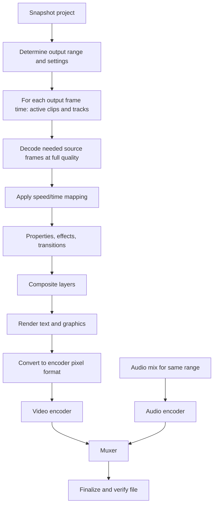

# Chapter 15: Export, Encoding, and Final Output

**Draft v1, 25 October 2026.** The pipeline and trade-offs are **[GENERAL]**. **CapCut Desktop's export dialog is not yet verified**: its exact fields, defaults, supported formats, and limits are **[UNKNOWN]** here. One secondary source claims desktop exports up to 4K [SECONDARY: skillademia.com, commercial interest], and another says the free tier is more limited than before and that watermark behavior depends on plan [SECONDARY: primalvideo.com]. A third says the Export keyboard binding differs between builds [SECONDARY: fastshortcuts.com]. Do not treat any of these as confirmed.

FFmpeg library roles used below (libavcodec encode/decode, libavformat muxing, libswscale conversion, libswresample audio conversion): FFmpeg documentation index, https://ffmpeg.org/doxygen/0.10/index.html, accessed 25 Oct 2026.

---

## 15.1 Export settings to document (to be verified in CapCut)

| Setting | What to record for CapCut | Status |
|---|---|---|
| File name, folder | Default naming, overwrite handling | [UNKNOWN] |
| Resolution / aspect | Presets, custom values, upper limit | [UNKNOWN] |
| Frame rate | Options, default | [UNKNOWN] |
| Container / format | MP4, MOV, others | [UNKNOWN] |
| Video codec | H.264, HEVC, others | [UNKNOWN] |
| Bitrate / quality | Presets or numeric | [UNKNOWN] |
| Audio | Format, bitrate, sample rate | [UNKNOWN] |
| Range | Whole timeline or selection | [UNKNOWN] |
| Hardware acceleration | Toggle, availability | [UNKNOWN] |
| Progress, cancel | UI | [UNKNOWN] |

This table is the checklist for Chapter 3 rows once official help pages are read.

## 15.2 Conceptual pipeline (general, not CapCut-verified)



Steps, in prose:

1. **Snapshot** the project so edits during export do not change output (Chapter 5, state bugs).
2. Resolve the **time range** and output frame count: `frames = round(duration * fps)`.
3. For each frame, run the **same evaluation** as preview (Chapter 9) at full quality and with original media, not proxies.
4. Convert color/pixel format to what the encoder accepts (libswscale-type work).
5. Encode video and audio **separately**, then **mux** into the container with correct timestamps.
6. **Finalize:** write the container index/trailer (for MP4, the metadata box is written at the end unless "fast start" relocates it to the front).
7. **Verify:** reopen the output, check streams, duration within a frame or two of expected, and that the file is playable.

## 15.3 Encoding concepts

**Rate control**

| Mode | Behavior | Use |
|---|---|---|
| Constant quality (CRF-like) | Quality target; size varies | Archive, general delivery |
| Target bitrate (VBR/ABR) | Hits an approximate average | Size-limited delivery |
| Constant bitrate (CBR) | Steady rate | Streaming ingest |
| Two-pass | First pass analyzes, second allocates bits | Best quality at a fixed size; slower |

**Presets:** slower software encoder presets spend more CPU time for smaller files at the same quality.

**Hardware vs software encoding**

| | Hardware encoder | Software encoder |
|---|---|---|
| Speed | Fast | Slower |
| Efficiency (quality per bit) | Often lower at equal bitrate | Often higher |
| Availability | Depends on GPU, driver, codec, OS | Always (CPU) |
| CPU load / heat | Lower | High |

Whether the target PC's integrated AMD GPU exposes usable encoders for H.264/HEVC/AV1 depends on its generation, drivers, and the Windows media stack. **Query at runtime; do not assume** (Chapter 20).

## 15.4 Practical guidance (general, not CapCut defaults)

Starting points an original editor might offer. These are common conventions, not requirements:

| Use | Resolution | Frame rate | Codec/container | Video bitrate (approx.) | Audio |
|---|---|---|---|---|---|
| Social vertical | 1080x1920 | match source (24-60) | H.264 in MP4 | 8-12 Mbit/s | AAC 128-192 kbit/s, 48 kHz |
| General 1080p | 1920x1080 | match source | H.264 in MP4 | 8-16 Mbit/s | AAC 192 kbit/s |
| 4K | 3840x2160 | match source | H.264 or HEVC in MP4 | 35-60 Mbit/s (H.264), less with HEVC | AAC 256 kbit/s |

Platforms re-encode uploads, so exporting at reasonable quality is usually enough; verify each platform's current published specs before fixing numbers.

## 15.5 Frame rate and timing issues

- **Frame-rate conversion:** project rate vs requested output rate: drop/duplicate (cheap, judder), blend (soft), or optical-flow (heavy). Document the default.
- **VFR sources:** map by timestamps; output is normally CFR.
- **A/V sync:** compute audio length from the exact timeline duration; encoder delay/priming samples must be accounted for in the container's timestamps; verify after export.
- **Color consistency:** tag the output's color space, range, and transfer correctly in the stream so players interpret it as intended (Chapter 14).

## 15.6 Resources and failure handling

- **Disk space:** estimate `size ~= (video_bitrate + audio_bitrate) * duration / 8`; check free space before starting; handle low space mid-export.
- **Temporary files:** write to a temp name in the target folder, rename on success; delete on cancel/failure.
- **Memory pressure:** bound frame queues in bytes; stream frames to the encoder instead of buffering the whole timeline.
- **Cancellation:** check a cancel token between frames; stop encoder, close files, remove temp output; leave the project untouched.
- **Interrupted export (crash):** a partial file may exist; name it so it is not mistaken for a finished export; offer cleanup on next start.
- **File name conflicts:** ask, auto-number, or overwrite with confirmation.
- **Errors:** report the stage (decode source X at time T, encode, mux, disk write) and cause, not just "export failed".
- **Responsiveness:** run export in a worker or separate process; keep the UI interactive; show progress as frames done over total frames with a remaining-time estimate that is smoothed, since frame costs vary.

## 15.7 Export job model [PROPOSED]

```text
ExportJob {
  id, project_snapshot_ref, settings,
  state: queued | preparing | rendering | encoding_flush | verifying
         | succeeded | failed(stage, error) | cancelled,
  frames_total, frames_done, started_at, output_path, temp_path
}
```

## 15.8 Test scenarios

| Scenario | Expected |
|---|---|
| Export 1-frame timeline | Valid file with one frame |
| Cancel at 50% | No final file; temp removed |
| Disk full at 90% | Clear error; temp removed |
| Source with VFR + audio | Audio stays in sync |
| Missing media on timeline | Warn before export; allow cancel or export with placeholders |
| Effects unavailable | Warn; output reflects the policy in 11.9 |
| Project edited during export | Output matches the snapshot |
| 59.94 fps timeline | Duration within one frame of expected |

## What a Future Coding Agent Must Understand

- Export evaluates the same timeline logic as preview, at full quality, from a snapshot.
- Encoding and muxing are distinct; finalize and verify before reporting success.
- Choose rate-control modes and hardware/software encoders deliberately; hardware support on the target PC must be detected at runtime.
- Plan for disk space, cancellation, interruption, and precise error reporting from the start.
- **Verified:** only FFmpeg's library roles. CapCut's export options are unverified.
- **Related:** Chapters 6, 9, 14, 20, 21, 24, 25.

---

## 15.9 Update: CapCut export facts now documented (added 25 Oct 2026)

Two CapCut-owned pages were read after the first draft of this chapter:

- **[S7]** "How Do I Export 2K/4K Videos in CapCut?", CapCut Help Center, dated 14 Jan 2026, https://www.capcut.com/help/export-videos-in-capcut (accessed 25 Oct 2026) **[OFFICIAL]**
- **[S8]** "How to Use CapCut on PC & Mac", CapCut, dated 10 Oct 2026, https://www.capcut.com/resource/how-to-use-capcut-on-pc (accessed 25 Oct 2026) **[OFFICIAL]**

Updated status of the 15.1 checklist:

| Setting | Status after S7/S8 |
|---|---|
| Entry point | Documented: "Export" button at the top right, then a second "Export" to start |
| Resolution | Documented: desktop offers 2K (2560x1440) and 4K (3840x2160) among options; the full list is still UNKNOWN |
| Frame rate | Documented: up to 60 fps depending on the source; a third-party guide lists 24, 25, 30, 50, 60 [SECONDARY] |
| Bitrate | Documented as adjustable (higher = better quality, larger file); recommended/lower/higher/custom [SECONDARY]; CBR/VBR claims are [SECONDARY] and unverified |
| Codec, format | Documented as settings in the export dialog (S8); values such as H.264, HEVC, MP4 are [SECONDARY] |
| File name, save location | Documented as dialog fields (S8 screenshot caption) |
| Hardware requirement | Documented: the computer needs sufficient GPU/CPU power and storage (S7); no explicit hardware-acceleration toggle documented |
| Availability conditions | Documented: which resolutions appear depends on device hardware, OS, platform, and source resolution (you cannot export 4K if all clips are 1080p or lower, stated for mobile); a higher frame rate may limit maximum resolution on mobile; web 4K depends on plan and cloud rendering |
| Plan limits | S7 says free web accounts may face watermarks or bitrate limits on 4K and Pro subscribers get unrestricted 4K; desktop plan limits are not stated in S7; secondary sources disagree on what is free |
| Progress, cancel, failure UI | Still UNKNOWN |
| Share after export | Documented: optional sharing to YouTube/TikTok (S8) |

Design implication: model **export option availability as a computed set** based on hardware capability, source media, plan, and project settings, and explain to the user why an option is missing (see Chapter 21).

## 15.10 Update: export dialog OBSERVED (25 Oct 2026)

A user screenshot (free plan) shows the export modal: Export timeline "Timeline 01", Name (auto-numbered), Export to (path and folder picker), a **Video** section (Remove watermark toggle with a Pro gem, Resolution dropdown, Bit rate dropdown "Recommended", Codec "H.264", Format "mp4", **Frame rate dropdown with 24, 25, 29.97, 30, 50, 59.94, 60 fps**, Optical flow with a gem, Color space row) and a collapsible **Audio** section, plus a footer estimating duration and file size ("1m 4s, about 22 MB"). The resolution option list, bit-rate options, codec and format lists, audio fields, progress screen, and cancel behavior were not captured. Details: `02-17_addendum_observed_screenshots_2-6.md`.
