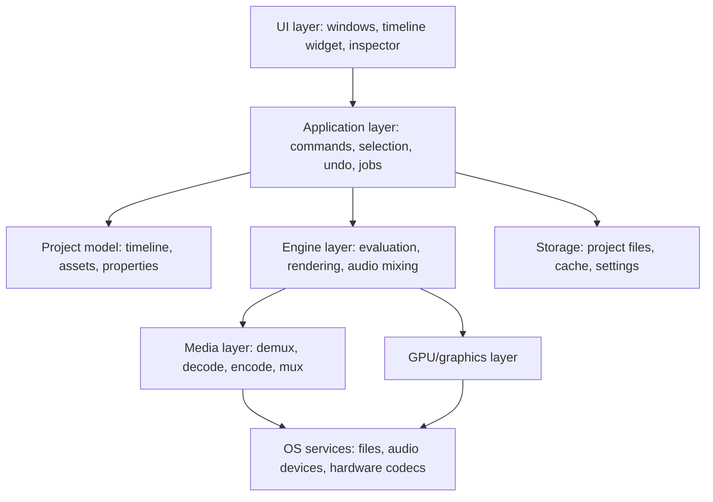

# Chapter 19: Windows Desktop Application Architecture

**Draft v1, 25 October 2026.** **[GENERAL]** and **[PROPOSED]**. Nothing here describes CapCut's technology, which is **[UNKNOWN]**. Official documentation for Qt, Electron, GStreamer, WinUI/WPF, Media Foundation, Direct3D, and Windows app-data/packaging has **not yet been fetched**; the statements below are widely known characteristics that the future coding agent must verify against those sources before committing. The only fetched citations are the FFmpeg library overview (https://ffmpeg.org/doxygen/0.10/index.html) and libavfilter page (https://ffmpeg.org/libavfilter.html), accessed 25 Oct 2026.

This chapter compares options and **does not choose** one.

---

## 19.1 Two separate decisions

| Decision | Question |
|---|---|
| GUI framework | How are windows, timeline widgets, menus, and input built? |
| Media/render engine | How are frames decoded, composited, encoded; how is audio played? |

Choosing a GUI framework does not solve decoding, timeline logic, rendering, encoding, or format compatibility. Each framework can host any engine, with different integration costs.

## 19.2 Layered architecture [PROPOSED]

Rule: the project model and engine should not depend on the UI framework. This keeps the core testable without a window and allows replacing the UI later.

## 19.3 GUI framework options

| Option | Strengths | Weaknesses | Notes for a small team |
|---|---|---|---|
| Native Win32/C++ with a UI library | Maximum control and performance; direct access to Windows APIs | Highest effort; custom widgets (timeline) by hand | Steep for a solo developer |
| Qt (C++ or Python bindings) | Mature cross-platform toolkit, rich widgets, custom painting, multimedia module, good for custom timeline views | Licensing terms must be read (LGPL/commercial); large deployment; learning curve | Strong candidate to study; verify licensing and Qt Multimedia limits |
| .NET (WPF/WinUI) | Fast UI development, strong Windows integration, good tooling | Windows-only; interop needed for native media libraries; performance care for custom drawing | Good fit with C# and native engine via interop |
| Electron/web tech | Fast UI iteration, large ecosystem, same skills as web | Heavy memory use; video pipelines require native addons or WebCodecs/WebGL; IPC cost for frames | Memory footprint matters on a 16 GB machine; verify current web video APIs |
| Rust UI toolkits | Memory safety, performance | Younger ecosystems; fewer ready-made complex widgets | Higher risk for UI-heavy apps |
| Other (Flutter desktop, Dear ImGui, etc.) | Specific strengths | Specific gaps (accessibility, text, native feel) | Evaluate per case |

No option is universally best.

## 19.4 Media engine options

| Option | What it provides | Trade-offs |
|---|---|---|
| FFmpeg libraries | libavformat (I/O, mux/demux), libavcodec (encode/decode), libavfilter (graph filtering), libswscale (conversion/scaling), libswresample (audio resampling/mixing) [OFFICIAL FFmpeg docs] | Broad format support; C API; **license obligations** depend on build configuration (LGPL vs GPL components, patent-encumbered codecs); you still write the editor logic |
| FFmpeg as separate process (CLI) | Simple integration for import/probe/export | Poor for interactive scrubbing; startup cost; fine for batch jobs |
| GStreamer | Pipeline framework with plugins | Windows packaging and plugin management are additional work; verify current Windows status |
| Windows Media Foundation | OS-integrated decode/encode, hardware acceleration via drivers | Windows-only; codec coverage depends on installed components; verify supported formats |
| Custom engine on a GPU API | Full control of compositing | Large effort |
| Combination | e.g., FFmpeg decode + own GPU compositing + hardware or software encoder | Most common for editors; most integration work |

Legal note: codecs such as H.264/HEVC can involve patent licensing in some distribution scenarios. This book does not give legal advice; consult official licensing information and counsel.

## 19.5 Concurrency model

- **UI thread:** input and painting only. Never decode, probe, or save here.
- **Worker pool:** probing, thumbnails, waveforms, proxy generation.
- **Playback threads:** decode, render, audio callback (real-time priority; no allocation or locks in the audio callback).
- **Export:** worker thread or process.
- **Communication:** message queues with version tags (Chapter 5, 5.11); immutable snapshots for read-only workers.

## 19.6 Process isolation

Options: single process (simplest, fastest data sharing) or separate engine/export/analysis processes (crash containment, memory cleanup when a process exits, ability to kill hung decoders). Costs: IPC design, frame transport (shared memory, GPU surface sharing), versioned protocols, more debugging. A middle path: run risky or heavy tasks (export, AI analysis, third-party plugins) in child processes while keeping interactive playback in-process.

## 19.7 GPU and hardware acceleration

- Graphics APIs on Windows: Direct3D 11/12, OpenGL, Vulkan; some UI toolkits abstract these (verify per toolkit).
- Hardware video decode/encode is exposed through OS or vendor APIs (for example through Media Foundation/DXVA and vendor SDKs); availability depends on GPU generation, driver, codec, profile, and bit depth.
- Always detect at runtime, always keep a software path, and expose a user setting to disable hardware acceleration (drivers misbehave).
- Handle GPU device loss and driver resets by recreating resources.

## 19.8 Operational concerns

| Concern | Approach |
|---|---|
| Logging | Rolling files in the per-user app-data directory; levels; no private content (file names optional/redacted; no media or caption text by default) |
| Crash reporting | Capture minidumps locally; ask permission before uploading anything |
| Packaging | Installer (MSIX or traditional installer), portable zip, or store distribution; each has different permissions, update, and file-association behavior; verify current Microsoft packaging docs |
| Updates | In-app check plus installer download, or store-managed; sign binaries; verify signatures |
| Dependencies | Pin versions; track licenses of every library; reproducible builds |
| Permissions | Write only to user-writable locations; handle read-only media, locked files, long paths |
| App data | Settings, cache, and recovery under per-user known folders (Roaming vs Local differ in what syncs: cache belongs in Local) |
| Temp files | Dedicated subfolder, cleaned on start and on completion |
| Preferences | Versioned settings file; defaults for missing keys |
| File association | Register a project extension; handle double-click opening in an already running instance (single-instance with message passing) |

## 19.9 Comparison for a small team (qualitative)

| Criterion | Qt/C++ | .NET + native engine | Electron + native addon | Native Win32 |
|---|---|---|---|---|
| Development effort | Medium-high | Medium | Medium (UI) / high (media) | High |
| Custom timeline drawing | Strong | Moderate | Web canvas/WebGL | Strong |
| Memory footprint | Moderate | Moderate | Higher | Lower |
| Windows integration | Good | Excellent | Good | Excellent |
| Cross-platform later | Yes | Limited | Yes | No |
| Packaging size | Medium-large | Medium | Large | Small |
| Frame transport to UI | In-process | Interop | IPC overhead | In-process |

These are qualitative generalizations to be validated by prototypes.

## 19.10 Spike experiments before committing

A short prototype for each candidate stack can answer: decode and display 1080p H.264 smoothly? Scrub a 4K long-GOP clip? Draw a 500-clip timeline at 60 fps UI? Export a 5-minute project? Memory use idle and during playback? Build and package size? Measure on the target PC (Chapter 20).

## What a Future Coding Agent Must Understand

- GUI framework and media engine are independent decisions with integration costs.
- Keep model and engine independent of the UI.
- Never run heavy work on the UI thread; plan threads, queues, and cancellation early.
- Hardware acceleration is detected and optional; software fallback is mandatory.
- Licensing (framework and codecs) can constrain the stack; check before committing.
- Packaging, updates, logging, and app-data locations are part of the architecture.
- **Verified:** only FFmpeg library roles. All other platform claims need official-documentation verification.
- **Related:** Chapters 5, 9, 15, 16, 20, 21, 29 decisions table.
