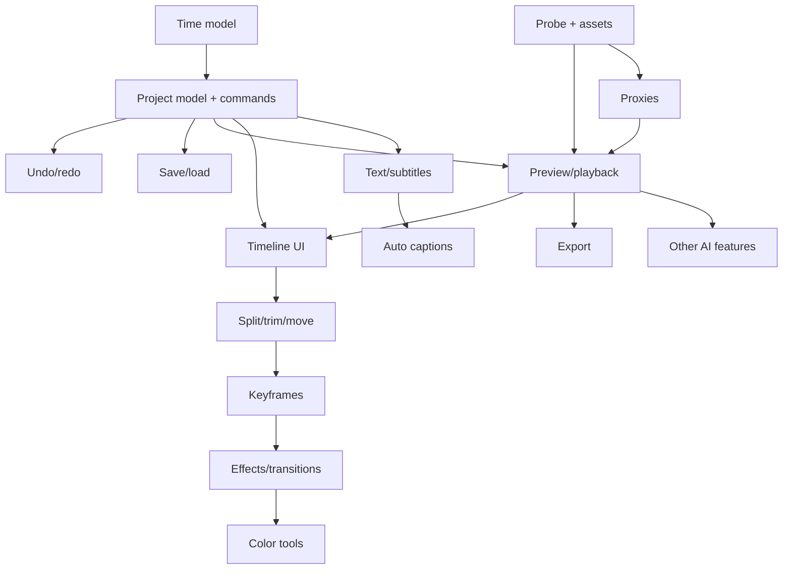

# Chapter 22: Product Scope and Feature Prioritization

**Draft v1, 25 October 2026.** **[PROPOSED]** classification based on dependency analysis of the earlier chapters. It is not a roadmap and does not instruct anyone to build anything now. Which features CapCut offers is only partly verified (Chapter 1); this chapter classifies by engineering dependency, not by CapCut parity.

Complexity scale: **S** (days), **M** (weeks), **L** (months), **XL** (separate research project). These are rough relative sizes, not estimates for any team.

---

## 22.1 Tier 0: Essential foundation

| Feature | Provides | Why it matters | Depends on | Complexity | Performance | Testing | Early target? |
|---|---|---|---|---|---|---|---|
| Time model (exact ticks, frame mapping) | Correct timing everywhere | Every later feature uses it | None | S | Negligible | Heavy unit/property tests | Yes |
| Project model + command layer | Single source of truth, one mutation path | Enables undo, save, validation | Time model | M | Low | Unit + property tests | Yes |
| Media probing + asset registry | Import with typed errors | Nothing works without it | FFmpeg-type library or OS media APIs | M | Disk-bound | Conformance corpus | Yes |
| Project save/load (atomic, versioned) | Durable work | Trust | Model | M | Low | Fault injection | Yes |
| Undo/redo | Safe editing | Expected by users | Commands | M | Memory bound | Property tests | Yes |
| Job system (cancel, progress) | Responsive UI | Used by import, thumbnails, export | None | M | CPU | Concurrency tests | Yes |

## 22.2 Tier 1: Core editing workflow

| Feature | Provides | Depends on | Complexity | Performance | Testing | Early target? |
|---|---|---|---|---|---|---|
| Single-frame preview and scrubbing | Visual feedback | Decode, frame cache | M | Seek cost, cache | Frame-accuracy tests | Yes |
| Real-time playback with audio clock | Playback | Decode threads, audio output | L | CPU/memory | A/V sync tests | Yes |
| Timeline UI (zoom, scroll, select, drag) | Core interaction | Model, thumbnails | L | Drawing virtualization | UI + unit | Yes |
| Split, trim, move, delete, ripple | Basic editing | Timeline model | M | Low | Property tests | Yes |
| Multi-track video + audio mix | Layered projects | Compositor, mixer | L | Per-layer decode | Render regression | Yes (2 tracks first) |
| Basic transform (position, scale, rotate, opacity) | Picture-in-picture, overlays | Compositor | M | GPU/CPU | Numeric tests | Yes |
| Export to a common format | Deliverable | Encoder, mux, snapshot | L | CPU/GPU heavy | Golden projects | Yes |
| Thumbnails and waveforms | Orientation | Job system | M | Background | Visual checks | Yes |
| Basic text/titles | Common need | Text layout, compositor | M-L | Low-medium | Font and script tests | Probably |

## 22.3 Tier 2: Advanced editing

| Feature | Depends on | Complexity | Notes |
|---|---|---|---|
| Keyframe animation + easing | Property system | M | Chapter 10 |
| Speed changes (constant), reverse | Time mapping, audio stretch | M-L | Audio and long-GOP complications |
| Transitions (cross-dissolve first) | Handles, two-stream decode | M | Chapter 11 |
| Basic effects and color adjust | Effect chain | M | Chapter 14 |
| Proxies and preview scaling | Job system, asset mapping | M | Essential on the target PC |
| Subtitle track + SRT import/export | Text, timing | M | Chapter 12 |
| Audio fades, gain, mute/solo | Mixer | S-M | Chapter 13 |
| Snapping, markers, multi-select | Timeline UI | S-M | Usability |
| Missing-media relink | Asset registry | M | Chapter 7 |

## 22.4 Tier 3: Professional workflow

| Feature | Depends on | Complexity | Notes |
|---|---|---|---|
| Speed curves (variable speed) | Time integration | L | |
| Graph/curve editor for keyframes | Bezier support | M-L | |
| Masks and animated masks | Compositor | L | |
| LUTs and richer color tools | Color pipeline | L | Chapter 14 |
| Compound/nested sequences | Recursive evaluation | L | |
| Roll, slip, slide edits | Edit-mode logic | M | |
| Audio loudness metering, EQ, compressor | DSP | L | |
| Export presets, queue, hardware encoders | Encoder integration | L | Detect capabilities |
| Project collection / packaging | File management | M | |
| Plugin or extension system | Stable APIs, sandboxing | XL | Requires API design |

## 22.5 Tier 4: AI-assisted capabilities

| Feature | Depends on | Complexity | Local vs service decision |
|---|---|---|---|
| Auto captions | Audio extraction, ASR model, alignment | L | Local model or cloud (Chapter 12) |
| Noise reduction / voice cleanup | DSP or model | L | Same |
| Background removal / segmentation | Model inference, temporal smoothing | L-XL | GPU/CPU cost on target PC |
| Motion tracking | Feature tracking | L | |
| Text-to-speech | Model/service | L | Voice licensing concerns |
| Auto reframe | Subject detection + keyframes | L | |
| Scene detection, media search | Analysis index | M-L | |
| Generative features | Large models/service | XL | Likely cloud, cost and policy implications |

AI features should write normal editable data (captions, keyframes, masks, parameters) so the rest of the app needs no special cases. Treat AI as optional plug-in capability behind clear interfaces (Chapter 18, pending).

## 22.6 Tier 5: Optional convenience

Templates, stock-asset browsers, brand kits, cloud sync, collaboration, mobile companion, auto-beat sync, recent files, workspace layouts, shortcut customization. Many rely on services or content licensing, which are product and legal questions beyond engineering.

## 22.7 High-complexity items requiring separate research

HDR and full color management; 3D transforms and perspective; multicam; advanced stabilization; optical-flow retiming; plug-in ecosystems; GPU-native render graph; real-time collaboration; DRM media; broadcast formats and timecode (drop-frame, MXF); cloud rendering.

## 22.8 Dependency overview

Reading: nothing in the upper-right can be reliable before the left-hand foundation. Preview and export share one evaluation path, so building them as separate systems is a cost-increasing choice.

## 22.9 Reasonable early implementation target (for planning only)

A consistent first milestone, by dependency: time model, project model/commands, probe/import, save/load, single-frame preview, timeline with split/trim/move on two video tracks and one audio mix, undo/redo, basic export. Everything else builds on it. The future coding agent decides actual scope.

## What a Future Coding Agent Must Understand

- Dependencies, not marketing features, determine build order.
- Tier 0 and Tier 1 define a usable editor; most other features are extensions of these.
- AI features should generate ordinary editable data and can be added late.
- Large-risk items (HDR, plug-ins, collaboration) are separate projects.
- **Verified:** none; this is an engineering classification.
- **Related:** Chapters 5, 7-16, 18-21.
