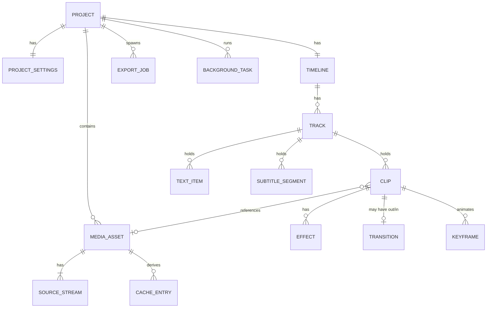

# Chapter 23: Proposed Conceptual Data Models

**Draft v1, 25 October 2026.** Everything here is a **[PROPOSED] illustrative design**. These are **not** CapCut's private data structures, which are **[UNKNOWN]**. Schemas show shape and constraints, not a required format.

Conventions: `Time` = integer ticks at a fixed timebase (Chapter 8). `Id` = UUID string. `Prop<T>` = animatable property (default value plus optional keyframes, Chapter 10).

---

## 23.1 Entity overview



## 23.2 Entities

### Project
Purpose: root document. Attributes: `id`, `format_version`, `created_with`, `last_saved_with`, `name`, `settings`, `assets[]`, `timeline`, `ui_state?`. Constraints: format version is required; ids unique; every referenced id exists.

### Project settings
`resolution {w,h}`, `frame_rate {num,den}`, `pixel_aspect`, `color {space, range, transfer}`, `audio {sample_rate, channel_layout}`, `background_color`, `timebase`. Constraints: positive dimensions; frame rate positive rational; changing them after editing triggers re-evaluation policy (do not silently rescale).

### Media asset
`id`, `kind (video|audio|image)`, `source {path_abs, path_rel, volume_hint}`, `fingerprint {size, mtime, hash}`, `streams[]`, `duration`, `status (ok|offline|unsupported|corrupt)`, `proxy_ref?`, `user_label?`. Constraint: never mutated by editing; `status` is runtime-derived and may be recomputed on open.

### Source-media metadata (streams)
Per stream: `type`, `codec`, `profile`, `pix_fmt/sample_fmt`, `w,h`, `rotation`, `pixel_aspect`, `avg_fps`, `vfr`, `color tags`, `sample_rate`, `channels`, `bitrate`, `duration`. Constraint: copied from probing; refreshed if the fingerprint changes.

### Timeline
`id`, `tracks[]`, `markers[]`, `duration` (derived, not stored as truth). Constraint: track order values are unique.

### Track
`id`, `kind (video|audio|text|subtitle)`, `order`, `locked`, `hidden`, `muted`, `solo?` (transient), `gain Prop<float>`, `clips[]`. Constraint: on non-overlay tracks, clips do not overlap; kind restricts allowed clip types.

### Clip
`id`, `type (media|text|generated|compound)`, `asset_id?`, `timeline_start`, `source_in`, `source_out`, `speed (Prop or curve)`, `reverse`, `link_group?`, `transform`, `opacity Prop`, `blend_mode`, `audio {gain Prop, pan Prop, fade_in, fade_out}`, `effects[]`, `transition_in?`, `transition_out?`, `enabled`, `name?`.
Constraints: `source_in < source_out <= asset.duration`; `speed > 0`; `timeline_start >= 0`; times on frame boundaries; `link_group` members share start offsets rule.

### Clip transformation
`position {x,y}`, `scale {x,y}`, `rotation`, `anchor`, `crop {l,t,r,b}`, `flip {h,v}`; all `Prop`. Constraint: scale non-zero; crop sums leave positive area.

### Keyframe
`time (clip-relative)`, `value`, `interp_out (hold|linear|bezier|ease_*)`, `handles?`. Constraint: sorted, unique times per property; value type matches property type.

### Effect
`id`, `type_id`, `type_version`, `enabled`, `order`, `params {name: Prop}`, `mask?`, `file_refs[]?` (LUTs, images). Constraint: params validated against the type's schema; unknown types preserved but marked unavailable.

### Transition
`id`, `type_id`, `type_version`, `duration`, `alignment (start|center|end)`, `params`. Constraint: duration <= available handles unless freeze policy applies.

### Text or title
`id`, `content_runs[] {text, style_override?}`, `style {font, size, color, stroke, shadow, background, align, spacing}`, `box {w,h?}`, `animation_in`, `animation_out`, `transform`. Constraint: font stored by name plus fallback list.

### Subtitle segment
`id`, `start`, `end`, `text`, `language`, `speaker?`, `words[]? {text,start,end}`, `style_ref?`. Constraint: `start < end`; optional non-overlap per track.

### Audio configuration
Project-level: `master_gain`, `limiter_enabled`, `loudness_target?`. Track/clip-level fields appear on tracks and clips.

### Export job
`id`, `project_snapshot_ref`, `settings {container, video_codec, audio_codec, resolution, fps, rate_control, bitrate/quality, range}`, `state`, `progress {frames_done, frames_total}`, `output_path`, `temp_path`, `error?`, `timestamps`. Constraint: settings validated against encoder capability before start. Not stored in the project by default.

### Background task
`id`, `kind`, `target`, `priority`, `state`, `progress`, `cancel_token`, `error?`. Runtime-only; never saved.

### Cache entry
`key (asset_id + content hash + parameters)`, `kind (thumb|peaks|proxy|frames|render)`, `path`, `size`, `last_used`, `created`. Constraint: rebuildable; evictable; validated on use.

## 23.3 Example (structured pseudodata)

```json
{
  "format_version": 3,
  "settings": {"resolution": {"w": 1920, "h": 1080},
               "frame_rate": {"num": 30000, "den": 1001},
               "audio": {"sample_rate": 48000, "channel_layout": "stereo"}},
  "assets": [{"id": "a1", "kind": "video",
              "source": {"path_rel": "media/interview.mp4"},
              "duration": 14400000,
              "streams": [{"type": "video", "codec": "h264", "w": 1920, "h": 1080,
                           "avg_fps": [30000,1001], "vfr": false, "rotation": 0},
                          {"type": "audio", "codec": "aac", "sample_rate": 48000, "channels": 2}]}],
  "timeline": {"tracks": [
    {"id": "t1", "kind": "video", "order": 0, "clips": [
      {"id": "c1", "type": "media", "asset_id": "a1",
       "timeline_start": 0, "source_in": 2400000, "source_out": 7200000, "speed": 1,
       "link_group": "g1",
       "transform": {"opacity": {"default": 1, "keys": []}},
       "effects": []}]},
    {"id": "t2", "kind": "audio", "order": 1, "clips": [
      {"id": "c2", "type": "media", "asset_id": "a1", "link_group": "g1",
       "timeline_start": 0, "source_in": 2400000, "source_out": 7200000, "speed": 1}]}]}
}
```

(Times in ticks at 240,000 ticks per second: 4,800,000 ticks = 20 s.)

## 23.4 How the models support operations

| Operation | Model support |
|---|---|
| Editing | Commands mutate clips/tracks and re-validate constraints |
| Saving | Serialize project (assets, timeline, settings); omit runtime-only entities |
| Restoration | Resolve asset paths, set status, rebuild indices and caches |
| Preview | Active-clip query + property evaluation + effect chain |
| Export | Snapshot project, then same evaluation at full quality |
| Undo | Commands store before/after for affected entities |

## 23.5 Validation pipeline

On load and after each command in debug builds: schema check, referential integrity, range checks, ordering and overlap checks, keyframe sort, unknown-type preservation. Report violations with entity ids.

## What a Future Coding Agent Must Understand

- Clips reference assets by id; edits change references and ranges only.
- Separate saved entities (project, assets, timeline) from runtime-only ones (tasks, caches, jobs).
- Properties are animatable by design; effects and transitions are versioned, parameterized records.
- Preserve unknown data on load; validate everything.
- These shapes are illustrative; the storage technology and exact fields are the implementer's decision (decisions table).
- **Verified:** none. **Related:** Chapters 7, 8, 10, 11, 12, 16, 24.
