# Chapter 25: Diagrams and System Relationships

**Draft v1, 25 October 2026.** All diagrams are **[PROPOSED]** engineering models in Mermaid. None shows CapCut's internal architecture, which is **[UNKNOWN]**. Each diagram is followed by a prose explanation.

---

## 25.1 Major editor subsystems

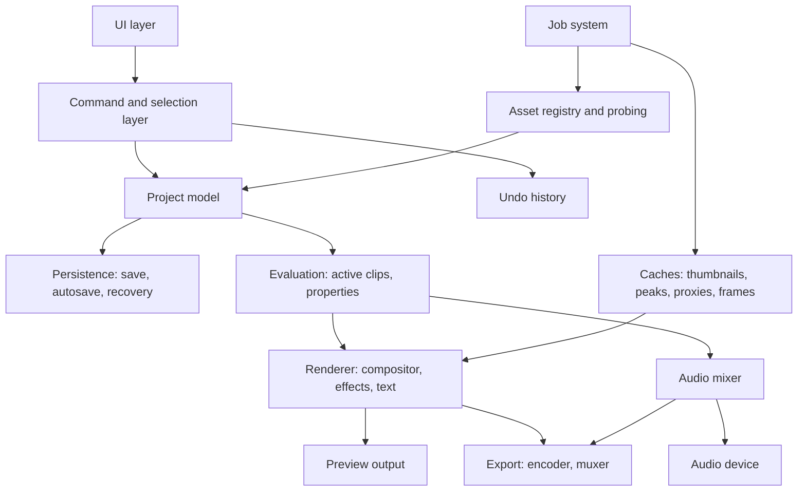

The model is the center. The UI only issues commands. Evaluation turns the model into per-time instructions for the renderer and mixer, and the same evaluation feeds preview and export. The job system builds disposable caches off the UI thread.

## 25.2 User-interface regions and conceptual relationships

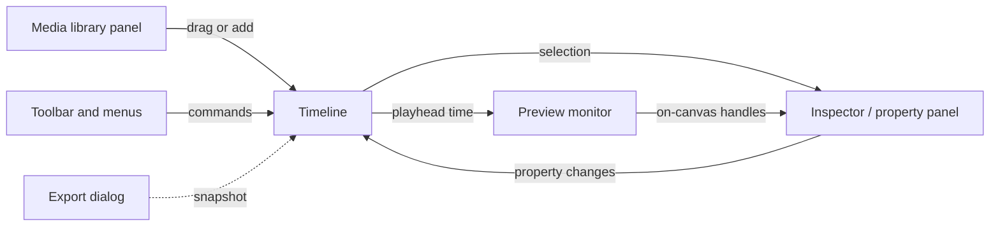

Regions are conceptual, not CapCut's exact layout (verification pending in Chapter 2). Selection in the timeline determines inspector content; on-canvas edits and inspector edits write the same properties through commands.

## 25.3 Media import and asset management

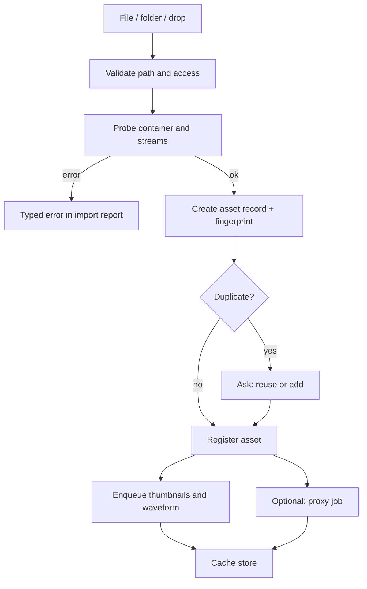

Registration is fast; heavy work is queued. Failures are reported per file without aborting a batch.

## 25.4 Timeline data relationships

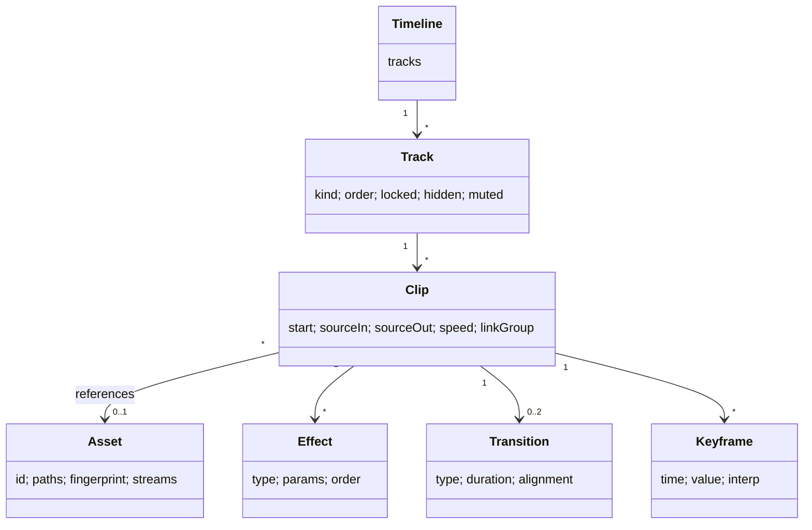

Clips point at assets by id and carry only ranges and parameters, which keeps editing non-destructive.

## 25.5 Preview-rendering flow

```mermaid
sequenceDiagram
    participant Clock as Playback clock (audio)
    participant Sched as Frame scheduler
    participant Dec as Decoder workers
    participant Cache as Frame cache
    participant Rend as Renderer
    participant UI as Preview surface
    Clock->>Sched: current time t
    Sched->>Cache: frame for t?
    alt hit
        Cache-->>Rend: decoded sources
    else miss
        Sched->>Dec: request decode (t, lookahead)
        Dec-->>Cache: frames
        Cache-->>Rend: decoded sources
    end
    Rend->>Rend: transform, effects, composite (preview quality)
    Rend-->>UI: present frame
    Note over Sched,UI: late frames are dropped; audio is never stalled
```

The audio clock leads; video adapts. Lookahead keeps decoders ahead of the clock.

## 25.6 Final-export flow

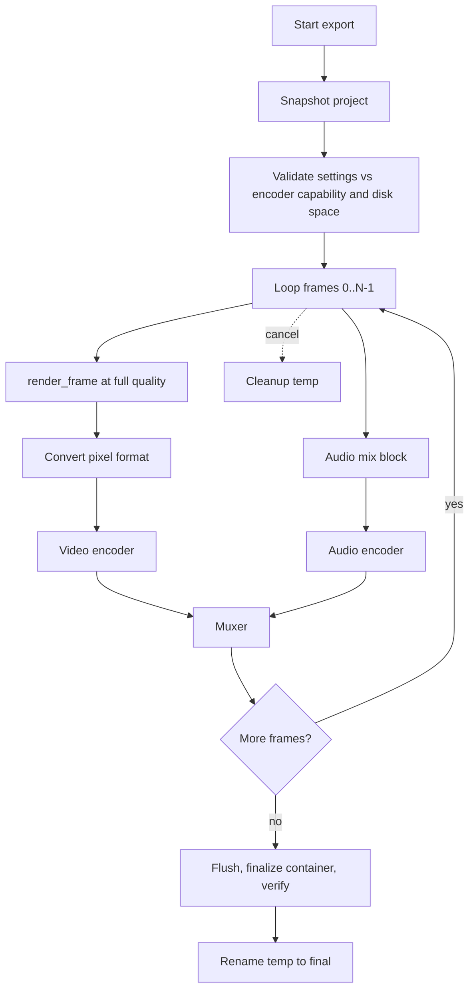

Cancellation is checked in the loop; success is reported only after verification and rename.

## 25.7 Project save and recovery

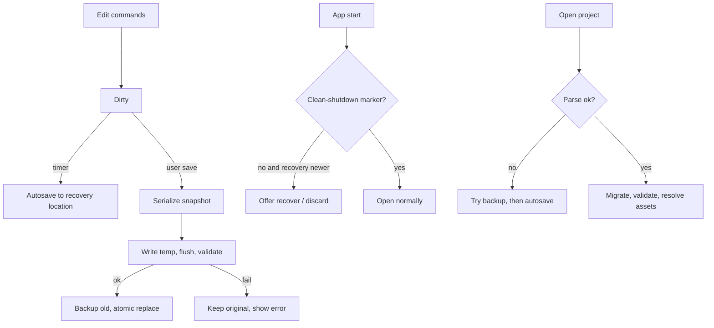

The user's file is never overwritten by autosave, and a failed save never destroys the previous version.

## 25.8 Undo and redo

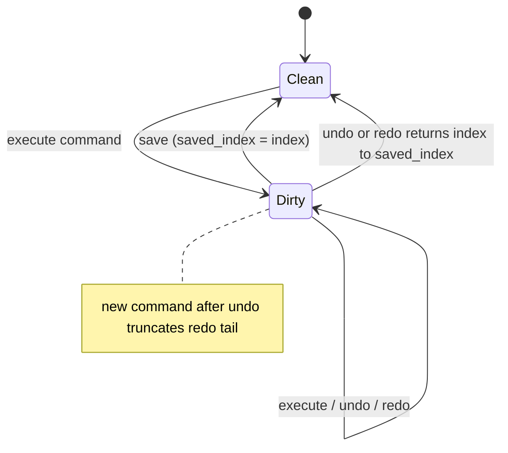

History is session data; the dirty flag compares the current history index with the index at the last save.

## 25.9 Background task execution

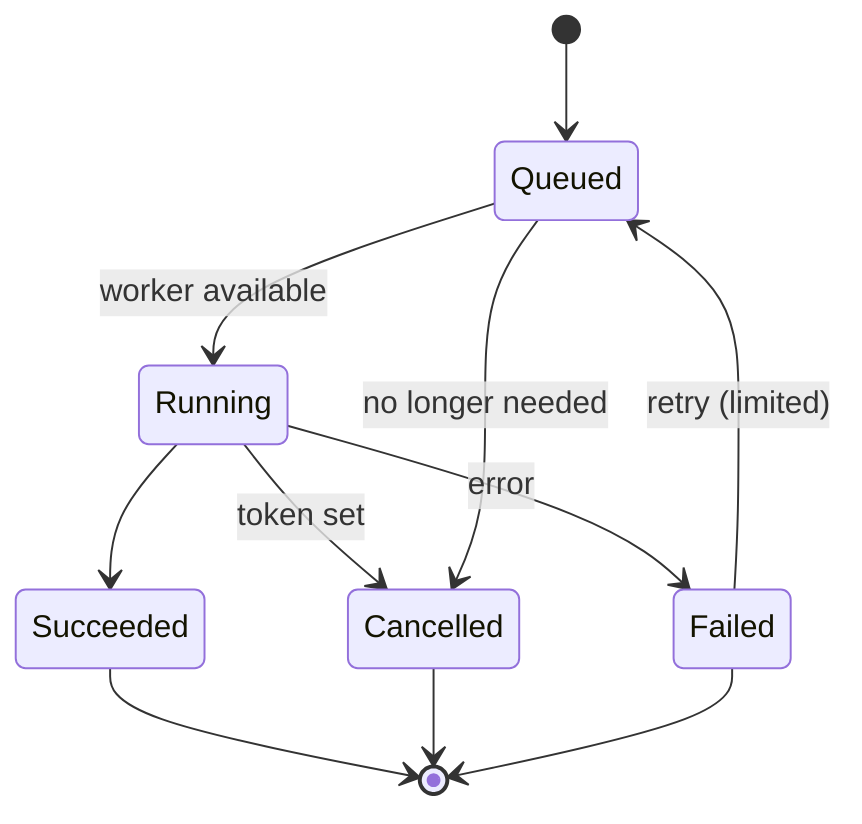

Priority orders the queue; visible-on-screen work runs first; cancelled jobs clean up and report state to the UI.

## 25.10 Typical edit session

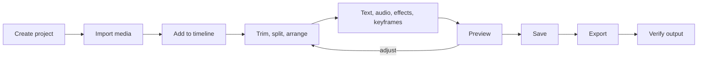

The loop between editing and preview dominates; save is continuous (autosave) and export is a terminal, snapshot-based step.

## 25.11 Source media, project data, preview output, caches, rendered output

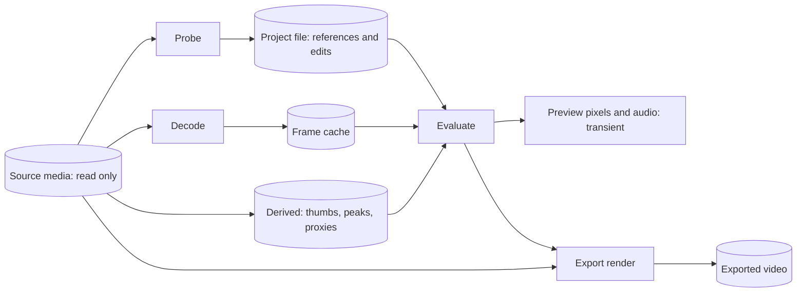

Only the project file and exported video are user-facing artifacts besides the sources. Caches and preview output are rebuildable. Export reads original sources, not proxies.

## 25.12 Layered compositing pipeline example

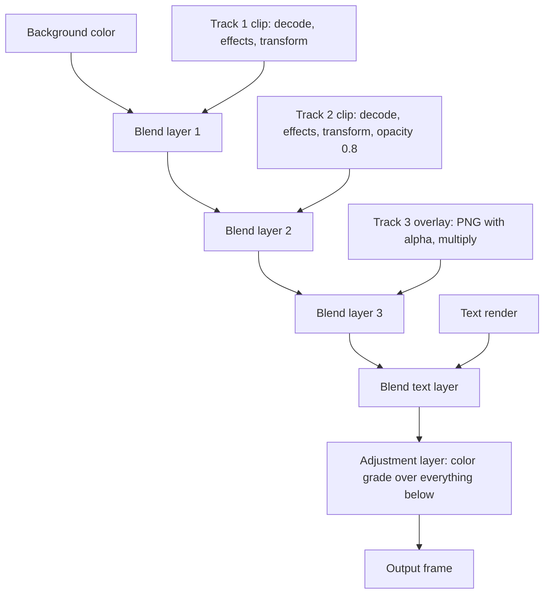

Layers composite bottom to top; an adjustment layer applies its effect to the accumulated image. Each node is evaluated at the frame's time with exact time arithmetic.

## What a Future Coding Agent Must Understand

- Diagrams express dependencies: model at the center, one evaluation path for preview and export, disposable caches, snapshot-based export and save.
- State machines (jobs, history, save) prevent impossible states.
- These are design models, not CapCut internals.
- **Related:** Chapters 5, 7, 8, 9, 15, 16, 22-24.
