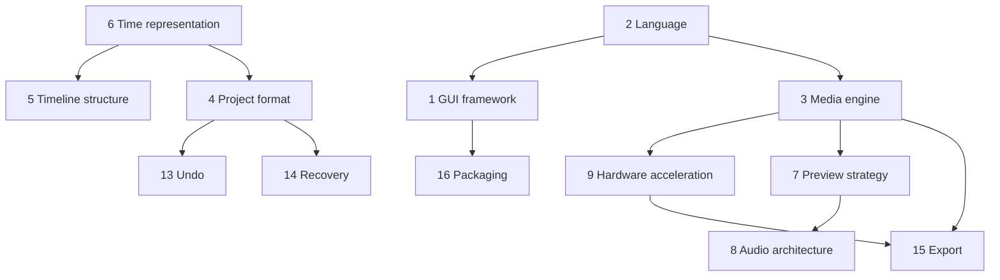

# Technical Decisions Reference (Textbook section 29)

**Draft v1, 25 October 2026.** This table lists decisions the future coding agent must make and the information needed to evaluate each. It deliberately **does not make the decisions**. Option lists are illustrative, not exhaustive. Facts about specific libraries and platform APIs must be verified against official documentation before deciding (several chapters list those verifications as pending).

---

## 29.1 Decision table

| # | Decision | Options | Evaluation criteria | Dependencies | Trade-offs and notes | Evidence needed first |
|---|---|---|---|---|---|---|
| 1 | Desktop GUI framework | Qt, .NET (WPF/WinUI), Electron/web, native Win32, Rust toolkits, other | Custom timeline widget feasibility, memory use, team skills, licensing, packaging size, accessibility, future cross-platform | Language, media engine integration | Framework does not solve media (Ch. 19) | Prototype spike: draw 500-clip timeline, show video frames |
| 2 | Programming language(s) | C++, C#, Rust, Python (UI/tooling), mixed | Media library bindings, performance-critical code, safety, tooling in VS Code, developer familiarity | GUI and media engine choice | Mixed-language boundaries add interop cost | Binding availability and build tooling |
| 3 | Media engine | FFmpeg libraries, FFmpeg CLI child process, GStreamer, Media Foundation, custom, combination | Format coverage, seeking behavior, hardware decode access, licensing (LGPL/GPL, codec patents), API stability, packaging | Language, hardware acceleration | CLI is simple but poor for scrubbing (Ch. 19) | Licensing review; decode/seek spike on target PC |
| 4 | Project-file format | Single JSON, zipped JSON, SQLite, binary custom | Project size, incremental save, debuggability, migration ease, crash safety | Undo design, autosave design | Chapter 16 | Expected project sizes; save-time test |
| 5 | Timeline representation | Per-track sorted arrays, interval trees, persistent structures | Edit cost, query speed, undo simplicity, large-project behavior | Time model | Chapters 8, 24 | Property-test harness |
| 6 | Time representation | Integer ticks, rational numbers | Exactness for 23.976/29.97/59.94, ease of arithmetic, overflow, serialization | None | Floats not acceptable for stored time | Frame-rate coverage list |
| 7 | Preview-rendering strategy | CPU compositor, GPU compositor, hybrid; in-process vs engine process | Frame rate at preview scales, memory bandwidth, driver risk, debugging | GUI/engine, GPU API choice | Chapter 9 | Measured preview benchmarks on target PC |
| 8 | Audio playback architecture | OS audio API directly, cross-platform audio library, engine-provided | Latency, device-change handling, sample-accurate clock, mixing in float | Preview strategy | Audio-master clock recommended pattern | Device-change tests |
| 9 | Hardware acceleration | None, decode only, decode+encode, full GPU pipeline | Actual codec/profile support on target GPU/driver, fallbacks, quality | Media engine, GPU API | Support is unverified for the target iGPU (Ch. 20) | Capability probe on the real machine |
| 10 | Cache policy | Memory only, memory+disk, size caps, eviction rule | RAM budget (16 GB shared with iGPU), disk speed, invalidation correctness | Asset hashing, job system | Chapter 7, 20 | Memory profile during long sessions |
| 11 | Proxy support | None, manual, automatic by threshold | Disk use, generation time, preview gain, UX complexity | Job system, asset model | Strongly relevant on modest hardware | Preview performance with and without |
| 12 | Background task system | Thread pool, task queue library, separate worker processes | Cancellation, priorities, crash isolation, progress reporting | Concurrency model | Chapters 5, 19 | Concurrency tests |
| 13 | Undo/redo architecture | Command + inverse, delta/patch, persistent data structures | Memory use, correctness under compound edits, transaction support | Project model | Chapter 16 | Property tests for invertibility |
| 14 | Project recovery | Autosave snapshots, command journal, both | Data-loss window, complexity, disk use | File format | Chapter 16 | Fault-injection tests |
| 15 | Export pipeline | In-process, child process; software, hardware, or both encoders; presets | Quality per bit, speed, responsiveness, cancelability, license of encoders | Media engine, hardware acceleration | Chapter 15 | Quality/speed comparison on target PC |
| 16 | Packaging and updates | MSIX, traditional installer, portable zip, store; auto-update method | Permissions, update reliability, signing needs, file associations, size | Framework, licensing | Verify current Microsoft packaging docs | Packaging spike |
| 17 | AI feature integration | None initially; local models; cloud services; hybrid | Privacy, offline use, cost, latency, hardware load, model licensing | Hardware budget, product policy | Chapters 12, 13, 18 | Local-model benchmark; service terms review |
| 18 | Testing strategy | Layers and tools per Chapter 21 | Coverage of time/edit logic, media corpus, regression tolerance, CI feasibility | All of the above | Build before UI-heavy work | Corpus plan |
| 19 | Color pipeline scope | Rec.709 SDR only; add HDR tone mapping; full management | Correctness needs, complexity, preview accuracy | Renderer | Chapter 14 | Target use cases |
| 20 | Text/layout engine | OS text APIs, framework text, dedicated shaping library | Complex-script support, font fallback, rendering quality | GUI/renderer | Chapter 12 | Script test set |
| 21 | Plugin/extension support | None, internal modular effects, public API | Security, API stability, support burden | Architecture | Likely out of early scope (Ch. 22) | Product goals |

## 29.2 How to use the table

1. Read the referenced chapters.
2. Gather the "evidence needed first" for the decisions that block others (1-3, 6, 9).
3. Run small spikes (Chapter 19.10) rather than deciding from documents alone.
4. Record each decision with date, options considered, evidence, and reasons (a decision log), so later changes are traceable.

## 29.3 Suggested ordering of decisions (dependency-driven)

This ordering reflects dependencies, not a prescribed sequence of work.
